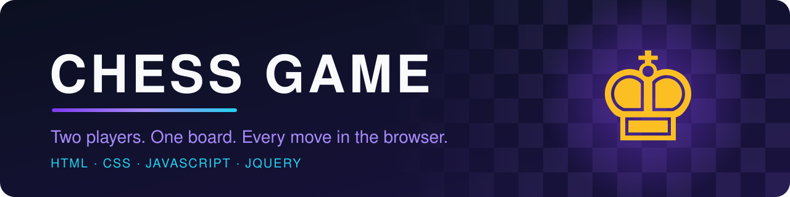
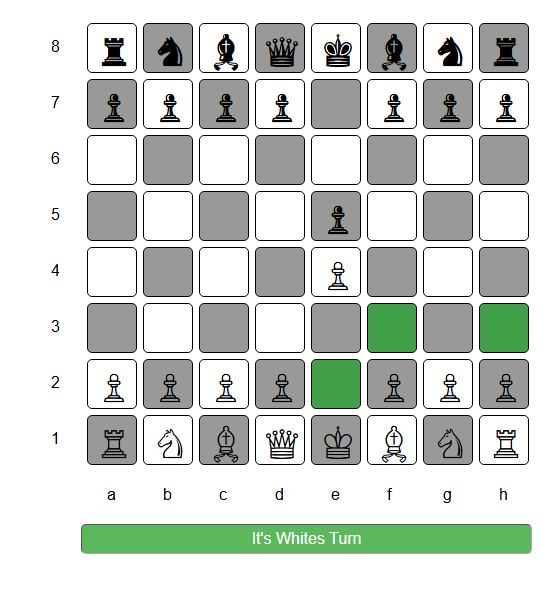
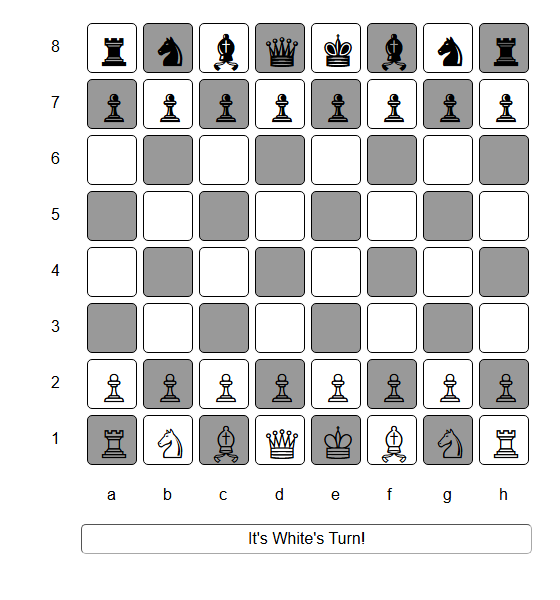
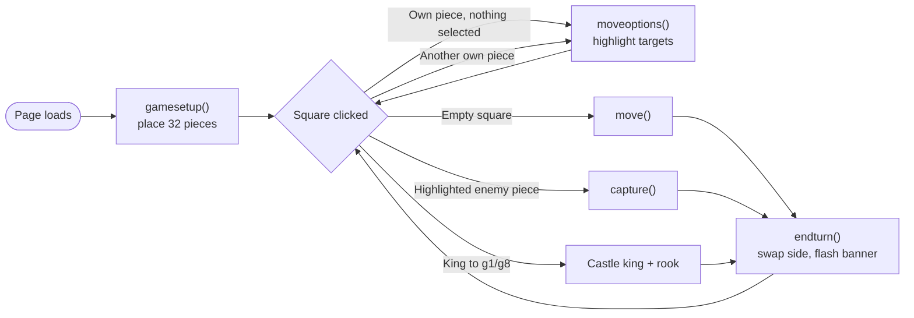

<div align="center">



<h3>♟ A two-player chess board that runs entirely in your browser</h3>

<p>
Pick a piece, see where it can go, and make your move. Built with plain HTML, CSS and JavaScript (plus jQuery). No build step, no install, no server.
</p>

<p>
  
  
  
  
  
</p>

<p>
  <a href="https://github.com/ruchirachowdary-1836/CHESS-GAME"><b>📂 View Source</b></a>
  &nbsp;&nbsp;•&nbsp;&nbsp;
  <a href="#getting-started"><b>🚀 Run It Locally</b></a>
  &nbsp;&nbsp;•&nbsp;&nbsp;
  <a href="https://github.com/ruchirachowdary-1836/CHESS-GAME/issues"><b>🐞 Report an Issue</b></a>
</p>



</div>

---

<div align="center">

**[Overview](#overview)** · **[Screenshots](#screenshots)** · **[Features](#features)** · **[Rule Coverage](#rule-coverage)** · **[Tech Stack](#technology-stack)** · **[Getting Started](#getting-started)** · **[How to Play](#how-to-play)** · **[How It Works](#how-it-works)** · **[Project Structure](#project-structure)** · **[Roadmap](#roadmap)** · **[Contributing](#contributing)** · **[License](#license)** · **[Author](#author)**

</div>

---

## Overview

**CHESS GAME** is a browser-based chess board for two players sharing one screen. White and Black take turns clicking pieces; the game shows each piece's reachable squares, moves or captures it, and hands the turn to the other side.

The whole game is one HTML page, one stylesheet and one script. The board is a grid of 64 `<div>` cells, the pieces are Unicode chess symbols, and all game state lives in a single JavaScript object, so the project is easy to read from top to bottom.

> [!NOTE]
> This is a **work-in-progress chess implementation**, not a full rules engine. It handles piece movement, captures, turns and kingside castling, but it does not yet detect check or checkmate. See [Rule Coverage](#rule-coverage) for exactly what is and isn't implemented.

## Screenshots

<table>
  <tr>
    <td align="center" width="50%">
      <br>
      <sub><b>Starting position</b>: labelled ranks and files, with a turn banner under the board</sub>
    </td>
    <td align="center" width="50%">
      <br>
      <sub><b>Move hints</b>: after 1. e4 e5, selecting the g1 knight highlights e2, f3 and h3</sub>
    </td>
  </tr>
</table>

## Features

### ♞ Gameplay

| | Feature | What it does | Why it matters |
|:-:|---|---|---|
| ♟ | **Full starting setup** | Places all 32 pieces on a labelled 8×8 board (ranks 1–8, files a–h). | You can start a game the moment the page loads. |
| 🎯 | **Per-piece movement rules** | Generates destinations for kings, queens, rooks, bishops, knights and pawns. Sliding pieces stop at the first piece in their path. | Each piece moves the way it should, and nothing jumps over pieces except the knight. |
| ♙ | **Pawn rules** | One square forward, two from the starting rank (only if the square in front is empty), and diagonal captures only onto enemy pieces. | Covers the pawn moves you use in almost every game. |
| ⚔️ | **Captures** | Taking a piece is only allowed on a highlighted square that holds an enemy piece. You can't capture your own pieces. | Stops illegal captures and keeps both sides honest. |
| 🏰 | **Kingside castling** | When the king and h-file rook haven't moved and f/g are empty, the king can castle short and the rook jumps to the f-file. | Supports one of the most common opening moves. |
| 🔁 | **Turn handling** | Only the side to move can select pieces; turns switch automatically after each move or capture. | Two players can share a device without mixing up turns. |

### 🎨 User experience

| | Feature | What it does |
|:-:|---|---|
| 💚 | **Move highlighting** | Selecting a piece turns its reachable squares green, with a subtle shake and glow animation. |
| 🔄 | **Quick re-selection** | Click a different piece of your own colour to switch selection; the highlights update right away. |
| 📣 | **Turn banner** | A banner below the board says whose turn it is and flashes green when the turn changes. |
| 🧭 | **Board coordinates** | Rank numbers and file letters are printed around the board for easy move reading. |
| 🖱️ | **No accidental menus** | The right-click context menu is turned off on the page, so stray clicks don't interrupt play. |

### 🛠 Engineering

| | Feature | What it does |
|:-:|---|---|
| 🧩 | **Single state object** | `main.variables` holds the turn, the selected square, the highlighted squares and all 32 pieces (position, `moved`, `captured`, type). |
| 🗺️ | **Coordinate IDs** | Every cell's id is `file_rank` (for example, `5_1` is e1), so board positions map straight to DOM elements. |
| 🚧 | **Bounds checking** | Candidate squares outside the 8×8 grid are filtered out before they are shown. |
| 📦 | **Zero tooling** | No bundler, package manager or compile step. Open the HTML file and it runs. |

## Rule Coverage

An honest look at which chess rules the current code handles:

| Rule | Status | Notes |
|---|:-:|---|
| Piece movement (K, Q, R, B, N, P) | ✅ | Generated in `moveoptions()` |
| Blocking for sliding pieces | ✅ | Rook, bishop and queen rays stop at the first piece |
| Pawn double step and diagonal capture | ✅ | Double step only from the starting rank |
| Captures | ✅ | Restricted to highlighted squares |
| Alternating turns | ✅ | `endturn()` swaps sides and updates the banner |
| Kingside castling (O-O) | ✅ | Both colours |
| Queenside castling (O-O-O) | ❌ | Not implemented |
| Enforcing highlighted squares for non-capturing moves | ⚠️ | Moves to **empty** squares aren't checked against the highlights yet |
| Check, checkmate, stalemate | ❌ | Not detected. A king can be captured and play continues |
| Pawn promotion | ❌ | Not implemented |
| En passant | ❌ | Not implemented |
| New game / reset button | ❌ | Reload the page to start over |

## Technology Stack

| Layer | Technology | Role in this project |
|---|---|---|
| Structure |  | `index.html` defines the 64 board cells, the coordinate labels and the turn banner |
| Styling |  | `style.css` handles the board layout, square colours, highlights and the keyframe animations (shake, neon glow) |
| Game logic |  | `script.js` handles the game state, movement rules, moves, captures, castling and turns |
| DOM helper |  | Selectors, click handling and class toggling. Loaded from the cdnjs CDN |
| Pieces | Unicode | The pieces are the chess symbols ♔ ♕ ♖ ♗ ♘ ♙ / ♚ ♛ ♜ ♝ ♞ ♟, so no image files are needed |

## Getting Started

### Prerequisites

- Any modern web browser (Chrome, Edge, Firefox or Safari)
- An **internet connection** the first time you load the page, because jQuery comes from `cdnjs.cloudflare.com`
- [Git](https://git-scm.com/) (optional, for cloning)

No Node.js, Python or package installation is required.

### 1. Clone the repository

```bash
git clone https://github.com/ruchirachowdary-1836/CHESS-GAME.git
```

```bash
cd CHESS-GAME
```

> Prefer not to use Git? Click **Code → Download ZIP** on GitHub and extract it.

### 2. Launch the game

The game lives in the `Chess-Game/` folder. Open `Chess-Game/index.html` in your browser, either by double-clicking it or from a terminal:

```bash
start Chess-Game/index.html      # Windows
```

```bash
open Chess-Game/index.html       # macOS
```

```bash
xdg-open Chess-Game/index.html   # Linux
```

You can also serve the folder with any static server you already use (for example, the VS Code *Live Server* extension).

### Troubleshooting

| Problem | Fix |
|---|---|
| The board appears but no pieces show up, and clicks do nothing | jQuery didn't load. Check your internet connection or whether something is blocking `cdnjs.cloudflare.com`, then reload. |
| Pieces look like empty boxes | Your system font is missing the Unicode chess glyphs. Try another browser or install a font that includes them (for example, *Segoe UI Symbol* or *DejaVu Sans*). |
| You can't select a piece | Only the side to move can select pieces. Check the turn banner under the board. |
| The board looks squeezed on a phone | The layout is designed for desktop widths. See the [Roadmap](#roadmap). |
| You want to start a new game | Reload the page. |

## How to Play

1. **White moves first.** The banner reads *"It's White's Turn!"*
2. **Click one of your pieces.** Its reachable squares light up green.
3. **Click a highlighted square** to move there, or a highlighted enemy piece to capture it.
4. **Changed your mind?** Click another of your own pieces to select it instead.
5. **Castle kingside** by moving the king two squares toward the h-file rook (e1 → g1 or e8 → g8) when the squares between them are empty and neither piece has moved.
6. The turn passes automatically and the banner flashes. Keep alternating until you decide the game is over.

> [!TIP]
> Check and checkmate aren't enforced yet, so players should call "check" themselves and agree when the game has ended.

## How It Works



1. **Board initialisation.** `index.html` contains 64 cells whose ids follow the `file_rank` pattern (`1_1` = a1 … `8_8` = h8). On `document.ready`, `gamesetup()` marks every cell empty (`chess="null"`), then writes each piece's Unicode glyph into its starting cell and tags the cell with the piece's key.
2. **Piece representation.** Every piece is an entry in `main.variables.pieces`:
   ```js
   w_knight2: { position: '7_1', img: '&#9816;', captured: false, moved: false, type: 'w_knight' }
   ```
   The first letter of the key (`w`/`b`) is its colour. `moved` is used for castling.
3. **Selection.** A click on a piece of the side to move calls `moveoptions()`. This builds candidate offsets for the piece type, converts them to cell ids, removes out-of-bounds squares and blocked rays, and toggles the `green shake-little neongreen_txt` classes on the results.
4. **Moving and capturing.** Clicking an empty square calls `move()`, and clicking a highlighted enemy piece calls `capture()`. Both update the DOM cell, the piece's `position` and `moved` flag, and (for captures) set the taken piece's `captured` flag.
5. **Castling.** If the king hasn't moved, the h-rook hasn't moved and the f/g squares are empty, `g1`/`g8` is added to the king's options. Choosing it moves the king and relocates the rook to `f1`/`f8`.
6. **Turn update.** `endturn()` clears the highlights, flips `main.variables.turn` between `'w'` and `'b'`, rewrites the banner, and briefly adds the `turnhighlight` class to flash it green.

## Project Structure

```text
CHESS-GAME/
├── Chess-Game/
│   ├── index.html      # Board markup: 64 cells, rank/file labels, turn banner; loads jQuery + script.js
│   ├── script.js       # Game state, movement rules, move/capture/castle handling, turn switching
│   ├── style.css       # Board layout, square colours, highlight + shake/neon animations
│   ├── light.css       # Light theme palette (not linked from index.html yet)
│   └── dark.css        # Dark theme palette (not linked from index.html yet)
├── assets/
│   ├── banner.svg      # README hero banner
│   └── screenshots/    # README gameplay screenshots
└── README.md
```

> [!NOTE]
> `light.css` and `dark.css` contain alternate colour schemes, but no page loads them yet. Wiring them up with a theme toggle is on the [Roadmap](#roadmap).

## Roadmap

**✅ Completed**

- [x] Playable 8×8 board with all 32 pieces and coordinates
- [x] Movement rules for every piece type, with blocking
- [x] Captures restricted to highlighted squares
- [x] Kingside castling for both colours
- [x] Turn switching with an animated banner
- [x] Light and dark theme stylesheets (not yet applied)

**🛠 Planned**

- [ ] Only allow moves to highlighted squares (non-capturing moves included)
- [ ] Check, checkmate and stalemate detection
- [ ] Pawn promotion
- [ ] Queenside castling and en passant
- [ ] A **New Game** button
- [ ] A light/dark theme toggle using the existing stylesheets
- [ ] Unit tests for the movement rules

**💡 Potential enhancements**

- [ ] Responsive, touch-friendly board for phones and tablets
- [ ] Move history in algebraic notation, with undo
- [ ] Captured-pieces tray
- [ ] Keyboard navigation and screen-reader labels
- [ ] A computer opponent for single-player mode
- [ ] Game clock
- [ ] Hosted live demo (for example, GitHub Pages)

## Contributing

Contributions, bug reports and ideas are welcome. Picking an item from the [Roadmap](#roadmap) is a great place to start.

1. **Fork** the repository on GitHub.
2. **Clone** your fork and create a feature branch:
   ```bash
   git clone https://github.com/<your-username>/CHESS-GAME.git
   ```
   ```bash
   git checkout -b feature/pawn-promotion
   ```
3. **Implement** your change inside `Chess-Game/`.
4. **Test** it by opening `Chess-Game/index.html` and playing through the moves your change affects for both colours.
5. **Commit** with a descriptive message:
   ```bash
   git commit -m "Add pawn promotion to queen"
   ```
6. **Push** and open a **Pull Request** that explains what changed and how you tested it.

Found a bug? [Open an issue](https://github.com/ruchirachowdary-1836/CHESS-GAME/issues) with the moves that reproduce it.

## License

This repository doesn't include a license file yet, so default copyright applies and others aren't granted rights to reuse the code. If you want it to be open source, choose a license (for example, at [choosealicense.com](https://choosealicense.com/)) and add a `LICENSE` file to the repository root.

## Author

<div align="center">

**[Ruchira Chowdary Talluri](https://github.com/ruchirachowdary-1836)**

Project: [ruchirachowdary-1836/CHESS-GAME](https://github.com/ruchirachowdary-1836/CHESS-GAME)

<br>

<i>“Every move is a decision; every bug is the next puzzle.”</i>

<sub>If you enjoyed this project, consider giving it a ⭐ on GitHub.</sub>

</div>
